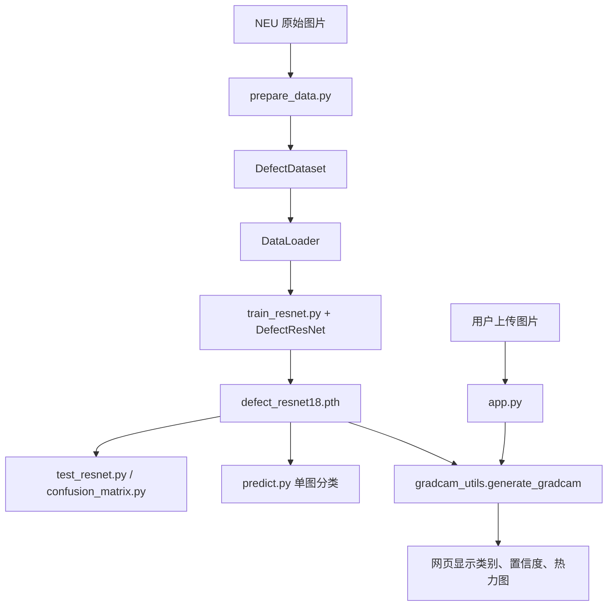

# 钢铁表面缺陷智能识别系统

基于 **ResNet18 迁移学习、Grad-CAM 和 Streamlit** 的钢铁表面缺陷图像分类项目。输入一张钢铁表面图片，系统输出缺陷类别、置信度，并展示模型关注区域，贯通数据处理、模型训练、评价和网页应用。

项目使用 NEU 钢铁表面缺陷分类数据集，同时保留自建 CNN baseline，便于学习和比较不同模型路线。当前任务是六类单标签图像分类，不输出目标检测框或像素级分割结果。

## 项目特点

- **深度学习图像分类**：自定义 PyTorch Dataset，支持批量训练与测试。
- **ResNet18 迁移学习**：加载 ImageNet 预训练参数，将分类头替换为六类输出，并进行全网络微调。
- **模型评估**：准确率、分类报告及混淆矩阵，观察各类误判情况。
- **Grad-CAM 可解释分析**：基于最后一个残差块，展示预测类别对应的关注热力图。
- **Streamlit 部署**：上传 BMP、JPG、PNG，点击检测后展示类别、置信度和热力图。
- **CNN baseline**：保留从零训练的卷积模型及其训练、评估脚本。

## 缺陷类别

类别编号必须与 Dataset、模型输出、预测列表保持相同顺序。

| 编号 | 英文类别 | 中文含义 | 原始文件前缀 |
| --- | --- | --- | --- |
| 0 | `crazing` | 龟裂 | `Cr` |
| 1 | `inclusion` | 夹杂 | `In` |
| 2 | `patches` | 斑块 | `Pa` |
| 3 | `pitted_surface` | 点蚀表面 | `PS` |
| 4 | `rolled-in_scale` | 轧入氧化皮 | `RS` |
| 5 | `scratches` | 划痕 | `Sc` |

## 项目结构

```text
inspectiontesting/
├── data/
│   ├── NEU-CLS/                  原始图片，按文件名前缀标识类别
│   └── processed_data/           六个类别子目录；根目录可有独立 test.bmp
├── models/
│   ├── cnn.py                    CNN baseline
│   ├── resnet.py                 ResNet18 六分类模型
│   ├── defect_cnn.pth            本地 CNN 权重
│   └── defect_resnet18.pth       本地 ResNet 权重
├── utils/
│   ├── prepare_data.py           图片分类归档
│   └── dataset.py                DefectDataset 封装
├── train.py                      CNN 训练
├── train_resnet.py               ResNet 训练
├── test.py                       CNN 评估
├── test_resnet.py                ResNet 评估
├── confusion_matrix.py          ResNet 混淆矩阵与分类报告
├── predict.py                   ResNet 单图预测函数和示例入口
├── gradcam.py                   离线 Grad-CAM 展示
├── gradcam_utils.py             返回类别、置信度及热力图的公共函数
├── app.py                       Streamlit 网页入口
├── test_dataset.py              数据读取、形状和类别数量检查
├── test_model.py                CNN 前向传播检查
├── requirements.txt             依赖清单
└── docs/
    ├── project_background.md    最初的项目背景
    ├── project_explanation.md   早期代码版本的详细说明
    ├── project_review.md        当前工程结构与代码质量报告
    └── learning_summary.md      结合当前代码的学习总结
```

`.venv/`、`__pycache__/` 为本地环境和缓存，不属于业务源代码。上述数据与权重是当前本地工作区资源；若仓库下载内容未包含它们，需自行准备，本文不假设 GitHub 已托管这些文件。



网页直接调用 `gradcam_utils.generate_gradcam()`，不会调用 `predict.py`，也不会现场训练模型。`predict.py` 是独立的单图预测入口。

## 环境安装

以下以 **Python 3.12、Windows PowerShell** 为例，在项目根目录打开终端。依赖版本以本次已检查的环境为基准；没有在新机器上完成全新安装验证。

### 1. 创建并激活虚拟环境

```powershell
python -m venv .venv
.\.venv\Scripts\Activate.ps1
python -m pip install --upgrade pip
```

已有本项目环境时可直接激活。若不使用激活脚本，可将后续 `python` 换成 `.\.venv\Scripts\python.exe`。Linux/macOS 的激活形式为 `source .venv/bin/activate`；本次运行检查基于 Windows 环境。

### 2. 选择 PyTorch 构建并安装依赖

无 CUDA 需求的 Windows/Linux 环境可先安装 CPU 构建：

```powershell
python -m pip install torch==2.5.1 torchvision==0.20.1 --index-url https://download.pytorch.org/whl/cpu
python -m pip install -r requirements.txt
python -m pip check
```

使用支持 CUDA 12.1 构建的 NVIDIA 环境时，用下面的命令替代上面的 CPU 安装步骤，再安装 `requirements.txt`：

```powershell
python -m pip install torch==2.5.1 torchvision==0.20.1 --index-url https://download.pytorch.org/whl/cu121
```

PyTorch 与 TorchVision 使用匹配版本；其他平台／CUDA 构建参考 [PyTorch 官方历史版本安装说明](https://pytorch.org/get-started/previous-versions/)。本项目没有使用音频处理，因此不安装 `torchaudio`。

清单使用 `opencv-python-headless`：Grad-CAM 通过 `cv2` 生成颜色映射和叠图，不需要 OpenCV 图形窗口。不要额外同时安装 `opencv-python`，两种发行包共用 `cv2` 命名空间。[OpenCV Python 官方打包说明](https://pypi.org/project/opencv-python-headless/)

当前本地环境两种 OpenCV 包都存在，本次没有卸载或升级任何库。依赖清单为新环境选择单一 headless 版本；`pip install -r` 不会自动清理已有重复安装。

### 3. 准备模型权重

网页和 ResNet 推理需要 `models/defect_resnet18.pth`；CNN 测试需要 `models/defect_cnn.pth`。可以使用已有对应权重，或按下文重新训练。

`DefectResNet` 构造时使用 `weights="DEFAULT"`，即使随后加载本地任务权重，仍会先查找 ImageNet 预训练权重缓存；首次运行、缓存不存在时需要联网下载。所有命令均应从项目根目录执行，以匹配当前相对路径。

## 数据准备

### 1. 放置原始数据

将 NEU 分类数据中的 BMP 图片放在 `data/NEU-CLS/`，例如 `Cr_1.bmp`、`PS_1.bmp`、`RS_1.bmp`。文件名前缀使用上表的大小写。

### 2. 整理与检查

**当前已知问题：** `utils/prepare_data.py` 的归档函数已能匹配六类，但文件末尾的统计代码引用了未定义的 `dataset`。直接执行下面的整理入口，会在归档函数返回后报 `NameError`；当前本地六类目录已经齐全。该问题在本次文档整理中未修改，不能把该命令视为无错误的数据流水线。

```powershell
python utils/prepare_data.py
```

整理后的目标结构为：

```text
data/processed_data/
├── crazing/
├── inclusion/
├── patches/
├── pitted_surface/
├── rolled-in_scale/
└── scratches/
```

已有完整类别目录时无需重复整理，直接检查：

```powershell
python test_dataset.py
```

本地核对结果为六类各 300 张，共 1,800 张；单张 Tensor 为 `[3,200,200]`。位于 `processed_data/` 根目录的 `test.bmp` 不会被 Dataset 读取。重新准备数据时，先处理整理入口的上述问题，再确认每类数量；不要仅凭目录已创建判断处理成功。

## 模型训练

### ResNet18 主路线

```powershell
python train_resnet.py
```

当前设置为：输入 `224×224`，batch size 32，10 个 epoch，Adam 学习率 0.001，交叉熵损失；固定划分种子 42，训练／留出比例 80%／20%，当前对应 1,440／360 张。模型自动选择可用 CUDA，否则使用 CPU。

所有 ResNet 层参与微调。脚本按**平均训练 Loss 最低**保存 `models/defect_resnet18.pth`；虽然创建了 `test_loader`，训练过程没有运行验证循环，因此这里的“最佳”不代表验证准确率最高。预处理为 Resize + ToTensor，没有额外 ImageNet Normalize。

### CNN baseline

```powershell
python train.py
```

CNN 使用三组卷积、ReLU 和池化，以及全连接分类头，当前适配 `200×200` 图片；训练结束保存 `models/defect_cnn.pth`。CNN 训练和测试尚未共享固定随机划分。

两个训练入口都可能覆盖同名已有权重。仅运行网页或测试时，不需要重新训练。本次工程整理未执行上述训练命令。

## 模型测试与解释

```powershell
# ResNet 准确率
python test_resnet.py

# ResNet 混淆矩阵、Precision / Recall / F1 分类报告
python confusion_matrix.py

# 单图分类，默认使用 crazing/Cr_1.bmp
python predict.py

# 原图与 Grad-CAM 对照图窗
python gradcam.py

# CNN baseline 评估与结构检查
python test.py
python test_model.py
```

ResNet 训练、测试和混淆矩阵脚本使用相同划分种子，但还依赖一致的数据清单与遍历顺序；历史权重没有记录训练样本清单。完整限制见检查报告。图窗脚本使用 `plt.show()`，不会自动将报告或热力图保存为文件。

## 网页运行

确认已安装依赖且存在 ResNet 权重后，从项目根目录执行：

```powershell
python -m streamlit run app.py
```

打开终端提示的 Local URL，通常为 `http://localhost:8501`。上传 `.bmp`、`.jpg` 或 `.png`，预览图片后点击“开始检测”。网页依次显示：

1. 上传图片。
2. 预测结果，例如英文类别 `crazing`。
3. 最大 Softmax 概率，以百分比显示。
4. Grad-CAM 模型关注区域。

当前网页会将上传图片转换为 RGB 并保存到临时 BMP，再调用 `generate_gradcam()`。该函数在每次检测时加载模型，并返回 `(label, confidence, visualization)`。当前未实现模型缓存、异常提示封装或临时文件清理，详情见检查报告。

## 示例效果说明

可用 `data/processed_data/crazing/Cr_1.bmp` 体验单图流程。本次对现有权重执行的单图检查返回 `crazing`，置信度处于 0～1，Grad-CAM 输出为 `224×224×3` 的 `uint8` RGB 图像；这只是功能检查，不是独立测试集准确率。

页面中暖色区域通常表示相对更强的类别贡献，热力图用于辅助观察模型判断依据，不等同于精确缺陷边界。类别置信度也不是全局准确率。当前未附截图或公开性能数字；截图、各类指标应来自实际运行记录，不使用演示数字替代。

## 技术文档与当前边界

- [工程结构与代码质量报告](docs/project_review.md)：逐文件分层、重复逻辑、硬编码路径、配置建议和运行风险。
- [项目学习总结](docs/learning_summary.md)：结合现有训练、预测、Grad-CAM 和网页代码解释 AI 概念。
- `docs/project_explanation.md` 和 `docs/project_background.md` 保留了早期阶段信息，其中“网页未实现”“两类为空”等描述已不适用于当前版本；当前状态以本 README 和本次检查报告为准。

当前系统是学习与演示用的六类缺陷分类应用，没有“正常／无缺陷”或“未知”类别。本次工程整理只新增文档与依赖清单，未移动文件、改动算法、改变数据或重新训练模型。
