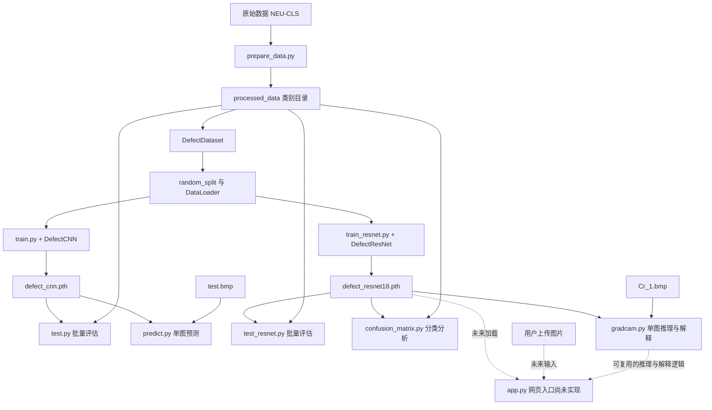
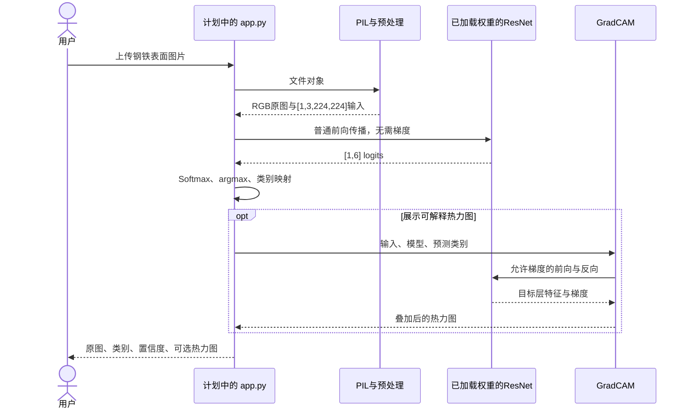

# 钢铁表面缺陷分类项目技术说明

本文先依据 `docs/project_background.md` 理解项目目标，再逐一分析项目自编 Python 文件、实际数据目录及模型权重。分析日期：2026-09-30。项目根目录：`D:/0AIprojects/inspectiontesting`。

文中区分三种信息：**当前实现**来自现有代码，**实际状态**来自本次只读检查，**计划流程**用于说明尚未完成的网页应用。本文不代表已经修复代码、重新训练模型或完成网页部署。

## 1. 整体目标、技术路线与当前进度

### 1.1 项目要解决什么问题

项目名称为“基于深度学习的钢铁表面缺陷智能检测系统”。当前算法任务是：输入一张钢铁表面图片，输出六种缺陷类别之一。

从机器学习任务定义看，这是**有监督、单标签、多类别图像分类**：训练图片有类别标签，一张图片对应一个类别，模型学习图片到类别之间的映射。现有代码没有输出缺陷框或逐像素掩码，因此尚不属于目标检测或语义分割实现；Grad-CAM 展示的关注区域也不能直接等同于缺陷标注。

六个类别的编号由 `utils/dataset.py` 中 `self.classes` 的排列决定：

| 类别编号 | Dataset 中的名称／目录名 | 中文含义 | 原始图片实际前缀 |
| --- | --- | --- | --- |
| 0 | `crazing` | 龟裂 | `Cr` |
| 1 | `inclusion` | 夹杂 | `In` |
| 2 | `patches` | 斑块 | `Pa` |
| 3 | `pitted_surface` | 点蚀表面 | `PS` |
| 4 | `rolled-in_scale` | 轧入氧化皮 | `RS` |
| 5 | `scratches` | 划痕 | `Sc` |

模型输出第 0～5 个位置的分数必须始终按上述顺序解释。当前没有“正常／无缺陷”和“未知类别”；即使输入不属于六类，取最大分数的逻辑仍会选出其中一类。

### 1.2 五个阶段的技术路线

| 阶段 | 目的 | 对应文件 | 当前状态 |
| --- | --- | --- | --- |
| 数据准备 | 从文件名前缀获得类别，整理成类别目录 | `utils/prepare_data.py`、`utils/dataset.py` | 已有代码，但两类数据未整理进去 |
| 自建 CNN | 学习卷积分类网络和完整训练过程 | `models/cnn.py`、`train.py`、`test.py`、`predict.py` | 已有代码及 CNN 权重 |
| ResNet18 迁移学习 | 用预训练特征进行缺陷分类微调 | `models/resnet.py`、`train_resnet.py`、`test_resnet.py` | 已有代码及 ResNet 权重 |
| 评估与解释 | 统计分类表现，观察模型关注区域 | `confusion_matrix.py`、`gradcam.py` | 已有独立脚本；评估划分存在问题 |
| 网页应用 | 上传图片，展示类别、置信度与热力图 | `app.py` | 文件为 0 字节，尚未实现 |

两条模型路线是并列实验：CNN 与 ResNet 分别训练、分别保存权重。ResNet 不读取 CNN 权重，也不是在 CNN 输出后继续分类。当前也没有自动选择最优模型或比较两模型结果的统一入口。

### 1.3 本次分析确认的关键事实

1. 原始数据包含 1,800 张 `200×200` 灰度 BMP，六类各 300 张。
2. 整理后的六个类别目录中，`pitted_surface` 和 `rolled-in_scale` 为空；`DefectDataset` 实际长度为 1,200，标签只有 `0、1、2、5`。
3. 原始文件用 `PS`、`RS`，整理代码用 `Ps`、`Rs`。Python 的 `str.startswith()` 区分大小写，导致这两类不匹配。Windows 文件系统的大小写行为不会改变该字符串比较规则。
4. `predict.py` 做 CNN 单图分类；`gradcam.py` 包含 ResNet 单图分类和 Grad-CAM；`app.py` 尚无任何调用。
5. 训练和测试脚本分别执行新的 `random_split()`，没有保存划分索引，也没有固定随机种子，不能保证测试集未参与训练。
6. 两个 `.pth` 文件能够作为参数字典读取，分类头尺寸与六类结构吻合；这只能说明结构可加载，不能证明六类都接受过有效训练，也不能据此推断准确率。

## 2. 项目目录与每个文件的作用

下面展示项目自编代码及主要资源。`.venv/` 是第三方运行环境，不作为项目自编源代码逐文件解释。

```text
inspectiontesting/
├── data/
│   ├── NEU-CLS/                    原始 BMP 图片；另有系统文件 Thumbs.db
│   └── processed_data/
│       ├── crazing/                300 张
│       ├── inclusion/              300 张
│       ├── patches/                300 张
│       ├── pitted_surface/         0 张
│       ├── rolled-in_scale/        0 张
│       ├── scratches/              300 张
│       └── test.bmp                独立单图预测样例
├── models/
│   ├── cnn.py                      自建 CNN 结构
│   ├── resnet.py                   ResNet18 包装与分类头替换
│   ├── defect_cnn.pth              CNN 参数
│   ├── defect_resnet18.pth         ResNet 参数
│   └── __pycache__/                Python 自动生成的字节码缓存
├── utils/
│   ├── prepare_data.py             整理原始图片
│   ├── dataset.py                  自定义 Dataset
│   └── __pycache__/                Python 自动生成的字节码缓存
├── train.py                        CNN 训练入口
├── train_resnet.py                 ResNet 训练入口
├── test.py                         CNN 准确率评估入口
├── test_resnet.py                  ResNet 准确率评估入口
├── predict.py                     CNN 单图预测入口
├── confusion_matrix.py            ResNet 混淆矩阵与分类报告
├── gradcam.py                      ResNet 单图可解释分析
├── app.py                          预留网页入口，目前为空
├── test_dataset.py                Dataset 人工检查脚本
├── test_model.py                  CNN 前向传播人工检查脚本
└── docs/
    ├── project_background.md      项目背景与学习目标
    └── project_explanation.md     本技术说明
```

### 2.1 `data/`：数据资源与真实数量

`data/NEU-CLS/` 平铺存放原始图片，例如 `Cr_1.bmp`、`PS_1.bmp`。标签不在单独的 CSV 中，而是编码在文件名前缀里。检查发现另有 `Thumbs.db`，它不是训练图片，整理脚本只处理 `.bmp`，会跳过它。

`data/processed_data/` 按类别建目录。每张图片的标签来自它所属目录，由 Dataset 中的固定类别表转成整数。训练脚本读取这个整理后的目录，不直接读取原始目录。

| 目录／范围 | 当前图片数 | 说明 |
| --- | ---: | --- |
| 原始数据 | 1,800 | 六类各 300 张，均为灰度 `200×200` |
| 已整理的类别目录 | 1,200 | 四类各 300 张，两类为空 |
| `processed_data/test.bmp` | 1 | RGB 图片，原始尺寸为宽 663、高 214 |
| `processed_data/` 下全部图片 | 1,201 | 包含独立的 `test.bmp` |
| Dataset 实际使用 | 1,200 | 只扫描六个类别目录，忽略根目录的 `test.bmp` |

因此，“磁盘上有多少图片”和“Dataset 会读取多少样本”需要分开统计。当前 `test.bmp` 不属于训练脚本的随机测试子集；它只是 `predict.py` 指定的单图输入。

### 2.2 `utils/prepare_data.py`：从原始文件名整理数据

该文件定义 `PROJECT_DIR`、`RAW_DATA_DIR`、`OUTPUT_DIR`、`CLASS_MAP`，并实现 `prepare_dataset()`。

执行顺序为：

1. 用 `Path(__file__).resolve().parent.parent` 定位项目根目录。
2. 创建六个类别目录，`exist_ok=True` 允许目录已存在。
3. 遍历原始目录，只保留后缀为 `.bmp` 的文件。
4. 用 `filename.startswith(prefix)` 查找类别。
5. 用 `shutil.copy()` 将图片复制到目标类别目录，并打印对应关系。

它只做**复制与分类归档**，没有缩放图片、归一化像素、划分训练测试集，也没有增强图片。重复运行会将同名文件复制到相同目标，并不会生成新的随机数据划分。

当前映射中的 `Ps`、`Rs` 与原始数据的 `PS`、`RS` 不一致，两类会被无提示地跳过。空目录仍然创建成功，所以后面的 Dataset 能正常构造，问题不一定表现为程序报错。

本文件有 `if __name__ == "__main__":`，直接运行才调用整理函数；导入该模块不会自动复制图片。

### 2.3 `utils/dataset.py`：定义一条样本如何读取

`DefectDataset` 继承 PyTorch 的 `Dataset`，三个核心方法如下：

| 方法 | 输入与职责 | 输出／内部状态 |
| --- | --- | --- |
| `__init__(data_dir, transform=None)` | 保存目录、变换和固定类别顺序，扫描各类别目录 | `self.images` 存路径；`self.labels` 存整数标签 |
| `__len__()` | 返回已收集路径数量 | 当前为 1,200 |
| `__getitem__(index)` | 按索引读图，转 RGB，执行传入的 transform | `(image, label)` |

扫描支持 `.bmp`、`.jpg`、`.png`，后缀判断会转小写；当前不包含 `.jpeg`。扫描只发生在类别目录的第一层，不递归扫描嵌套目录，且没有显式排序。目录必须存在，否则 `iterdir()` 会失败；空目录则不会触发类别缺失检查。

实例化 Dataset 时主要保存路径和标签，不会一次把所有图片读进内存。真正访问 `dataset[i]` 时才执行：

```python
image = Image.open(img_path).convert("RGB")
if self.transform:
    image = self.transform(image)
return image, label
```

对于灰度 NEU 图片，RGB 转换提供三个内容相同的通道，满足模型三通道输入要求，并不凭空增加颜色信息。不提供 transform 时返回 PIL 图片；现有训练、测试入口均传入了 Tensor 变换。

### 2.4 `models/cnn.py`：自建卷积神经网络

`DefectCNN(nn.Module)` 分成 `features` 和 `classifier` 两部分。`forward(x)` 先提取空间特征，再完成分类。

以下形状基于当前 `200×200` RGB 输入，`B` 表示批量大小：

| 操作 | 输出形状 | 作用 |
| --- | --- | --- |
| 输入 | `[B, 3, 200, 200]` | 原始三通道 Tensor |
| `Conv2d(3,16,3,padding=1)`、ReLU | `[B,16,200,200]` | 提取局部纹理；卷积不改变宽高 |
| `MaxPool2d(2)` | `[B,16,100,100]` | 空间下采样 |
| `Conv2d(16,32,3,padding=1)`、ReLU、池化 | `[B,32,50,50]` | 提取更复杂特征 |
| `Conv2d(32,64,3,padding=1)`、ReLU、池化 | `[B,64,25,25]` | 获得高层特征图 |
| `Flatten()` | `[B,40000]` | `64×25×25=40000` |
| `Linear(40000,128)`、ReLU | `[B,128]` | 汇总空间特征 |
| `Linear(128,6)` | `[B,6]` | 输出六个 logits |

本模型共有 5,144,486 个可训练参数，其中第一个全连接层就有 `40000×128+128=5,120,128` 个，占绝大多数。它适合学习基础流程，但在当前小数据量下需要关注过拟合。

第一层全连接的输入固定为 40,000，要求卷积后得到 `25×25` 空间尺寸。现有数据的 `200×200` 与其匹配；不能任意更换输入尺寸。例如输入 `224×224` 会得到 `64×28×28`，与该全连接层不匹配。模型末尾没有 Softmax，因为训练的交叉熵直接接收 logits。

### 2.5 `models/resnet.py`：ResNet18 迁移学习模型

`DefectResNet(nn.Module)` 在构造时执行：

```python
self.model = models.resnet18(weights="DEFAULT")
in_features = self.model.fc.in_features
self.model.fc = nn.Linear(in_features, num_classes)
```

其含义是：先创建 ImageNet 预训练的 ResNet18，再把原来输出 1,000 类的分类头换成 `Linear(512,6)`。`forward(x)` 将输入交给 `self.model(x)`。

当前环境 TorchVision 0.20.1 中，ResNet18 的 `DEFAULT` 对应 `IMAGENET1K_V1`。新建的六类分类头随机初始化，特征提取部分继承预训练参数。代码没有冻结任何层，训练时优化器接收 `model.parameters()`，因此执行的是**全网络微调**。

更换分类头后，可训练参数为 11,179,590。参数字典中的名称带有外层包装前缀，例如 `model.conv1.weight`、`model.fc.weight`。

需要注意，测试和解释脚本也先调用这个构造函数，再加载本地缺陷权重。这意味着即使本地 `.pth` 已存在，构造时仍会先查找 ImageNet 权重缓存；没有缓存时可能尝试下载。

### 2.6 `models/*.pth`：训练得到的参数文件

| 文件 | 由哪个入口保存 | 哪些入口读取 | 已核对的分类头 |
| --- | --- | --- | --- |
| `defect_cnn.pth` | `train.py` | `test.py`、`predict.py` | `[128,40000]` 和 `[6,128]` |
| `defect_resnet18.pth` | `train_resnet.py` | `test_resnet.py`、`confusion_matrix.py`、`gradcam.py` | `[6,512]` |

保存内容是 `model.state_dict()`，不是完整 Python 程序。里面包含可训练参数以及 BatchNorm 等模块的持久缓冲区；不会自动附带类别名称、预处理方式、训练数据划分、训练轮次或优化器状态。

本次采用只读方式加载并核对了张量形状与数值有限性。当前权重文件没有可追溯训练记录，因此不能确认它们一定由“当前版本代码加当前数据目录”训练而来。

### 2.7 `train.py`：CNN 训练入口

训练设置为 batch size 32、epochs 10、学习率 0.001。预处理只有 `ToTensor()`，依赖输入图片本来就是适合 CNN 的尺寸。

执行流程是：创建 Dataset → 随机划分 80%／20% → 为训练子集创建打乱顺序的 DataLoader → 创建 CNN → 创建交叉熵损失和 Adam → 循环训练 → 保存最终权重。

虽然创建了 `test_dataset`，但本文件没有使用它做验证，也没有计算每轮准确率、保存最佳轮次或绘制学习曲线。打印的 Loss 是各 batch 平均损失的算术平均；当最后一批更小时，它与按样本加权的全数据平均损失会略有区别。

### 2.8 `train_resnet.py`：ResNet18 微调入口

训练框架和超参数与 CNN 相同，主要区别是预处理增加 `Resize((224,224))`，并使用 `DefectResNet(num_classes=6)`，最终保存到 `models/defect_resnet18.pth`。

当前变换为“缩放 + 转 Tensor”，没有 ImageNet 均值／标准差标准化、随机增强、学习率调度、早停、梯度裁剪或训练日志文件。所有层都会更新。训练结束保存最后一轮参数，没有根据验证结果选择最佳模型。

### 2.9 `test.py` 与 `test_resnet.py`：准确率评估入口

两个脚本分别加载 CNN 和 ResNet 权重，创建测试 DataLoader，执行 `model.eval()`，在 `torch.no_grad()` 下逐批前向传播，取 `torch.max(outputs,1)` 的索引作为预测标签，统计正确数与总数，打印准确率。

它们不更新权重。CNN 使用原尺寸 Tensor；ResNet 缩放到 `224×224`。`test.py` 用 `int(0.2*N)` 计算测试数量，其他主要脚本使用 `N-int(0.8*N)`；当前样本量下结果一致，但对某些样本数，两种取整方法可能相差 1。

更重要的是，这些脚本没有恢复训练时的划分。`test_resnet.py` 的“和训练保持一致”注释只对应划分比例，不能保证样本身份一致。因此当前打印值不能直接当作严格独立测试集上的泛化指标。

### 2.10 `predict.py`：CNN 单张图片预测

该脚本固定读取 `data/processed_data/test.bmp`，先 RGB 转换，再缩放到 `200×200`，转 Tensor，并用 `unsqueeze(0)` 添加 batch 维度；随后加载 CNN 权重、计算六类分数、Softmax 概率和最大概率索引，最后在终端打印类别与两位小数百分比。

它没有读取命令行图片参数，也没有上传控件，不使用 ResNet。类别编号 4 写成 `rolled_in_scale`，与 Dataset 中 `rolled-in_scale` 的拼写不同；顺序仍一致，所以当前影响的是显示名称，而不是类别编号。

当前样例 `test.bmp` 为宽 663、高 214，直接缩放为正方形会改变图像比例。脚本能完成尺寸适配，但这类输入与训练图片的尺寸比例和成像内容可能存在分布差异。

### 2.11 `confusion_matrix.py`：ResNet 误分类分析

该脚本重新随机划分测试子集，加载 ResNet 权重，收集所有真实标签和预测标签，然后调用 scikit-learn 的 `confusion_matrix()` 和 `classification_report()`。

前者输出“真实类别 × 预测类别”的计数矩阵，后者输出 Precision、Recall、F1 和 support 等指标。Seaborn 的 `heatmap()` 负责画矩阵，Matplotlib 设置坐标轴与标题，最后 `plt.show()` 展示图窗。没有保存 PNG 或报告文件。

图中类别名对点蚀、氧化皮用了简写 `pitted`、`rolled_scale`。当前代码没有显式传 `labels=[0,1,2,3,4,5]`；如果真实标签和预测标签的并集中缺少某些类别，返回矩阵可能小于 `6×6`。由于坐标轴标签仍硬编码六个，可能产生标签与矩阵位置不对应的问题。分类报告也没有通过 `target_names` 显示完整类别名称。

### 2.12 `gradcam.py`：ResNet 单图解释

固定输入为 `data/processed_data/crazing/Cr_1.bmp`。脚本先完成 `224×224` 预处理并加载 ResNet，在无梯度环境下获得预测类别编号，再用 `model.model.layer4[-1]` 作为目标层，构造 `GradCAM` 和 `ClassifierOutputTarget(prediction)`。

随后在可以记录梯度的环境下调用 CAM，得到二维关注强度图，并将其与缩放后的 RGB 图片叠加。最终用 Matplotlib 并排显示原图和热力图，终端打印预测编号。

`grayscale_cam[0]` 是取 batch 中第一张图片的热力图，不是取“类别 0”的图。该脚本没有网页输出，也不把图保存到文件；解释目标是模型预测的类别，而不是自动使用图片文件夹里的真实类别。

### 2.13 `app.py`：预留网页入口

本次读取确认文件长度为 **0 字节**。当前没有导入 Streamlit，没有上传图片、加载模型、推理、显示置信度或显示热力图的代码。项目 `.venv` 中也未安装 Streamlit。

背景文档描述的网页应用仍属于下一阶段目标。第 5 节详细说明如何在现有能力基础上组织上传预测流程，但其中的网页步骤不应被理解为已经实现。

### 2.14 其余自编文件与辅助目录

| 文件／目录 | 作用与边界 |
| --- | --- |
| `test_dataset.py` | 构造 Dataset，打印样本数、首张 Tensor 形状和标签，用于人工检查；没有断言，也没有检查六类是否完整 |
| `test_model.py` | 创建未加载训练权重的 CNN，用随机 `[1,3,200,200]` 输入检查输出；只能检查前向传播和形状，不能检验预测准确率 |
| `docs/project_background.md` | 给出项目目标、学习路线与网页计划，不参与运行 |
| `models/__pycache__/`、`utils/__pycache__/` | Python 导入模块生成的缓存，不是模型训练成果 |
| `.venv/` | 本地 Python 解释器及第三方包；当前项目没有独立依赖清单或锁文件 |
| `.git/` | 版本控制元数据，不参与深度学习流程 |

除数据整理脚本使用 main guard 外，多数训练、测试、预测和解释入口直接在模块顶层执行。导入这些入口文件可能立即触发读数据、训练或弹图，因而它们目前适合作为独立脚本运行，而不是直接作为网页的可复用函数库。

## 3. 文件之间的调用关系与数据流

### 3.1 要求中的完整流程

下面按“数据集 → Dataset → DataLoader → 模型 → 训练 → 保存权重 → 预测 → 网页”展示整体路线。最后一步尚未接通；ResNet 单图推理目前存在于 Grad-CAM 脚本中。

```text
数据集：data/NEU-CLS 原始图片
    ↓ utils/prepare_data.py 按前缀复制
类别目录：data/processed_data
    ↓
Dataset：utils/dataset.py 中的 DefectDataset
    ↓ random_split 划分子集
DataLoader：按 batch 读取图片和标签
    ↓
模型：DefectCNN 或 DefectResNet
    ↓
训练：train.py 或 train_resnet.py
    │ 前向传播 → CrossEntropyLoss → backward → Adam.step
    ↓
保存权重：models/defect_cnn.pth 或 defect_resnet18.pth
    ↓
预测：新建同结构模型 → 加载权重 → eval → 前向传播 → 类别
    │ CNN 单图入口为 predict.py
    │ ResNet 单图逻辑目前在 gradcam.py
    ↓ 待接入
网页：app.py 上传图片、展示结果和 Grad-CAM【尚未实现】
```

这里的模型位于训练循环内部，并非“模型处理结束后才开始训练”。训练阶段不断调用模型并更新参数；预测阶段则使用训练后固定的参数。

### 3.2 两条模型路线的产物关系

实线表示已有的读取、调用或产物关系；虚线表示计划关系。



图中共享的 `random_split 与 DataLoader` 表示相同处理步骤，不表示各脚本共享同一个已经保存的划分。测试和混淆矩阵入口会自行创建 Dataset、重新划分并创建 DataLoader。

### 3.3 Python 模块导入关系

| 入口文件 | 直接导入的项目模块 | 主要外部能力 |
| --- | --- | --- |
| `train.py` | `utils.dataset.DefectDataset`、`models.cnn.DefectCNN` | DataLoader、random_split、transforms、CrossEntropyLoss、Adam |
| `train_resnet.py` | `DefectDataset`、`models.resnet.DefectResNet` | 与 CNN 训练相同的训练框架 |
| `test.py` | `DefectDataset`、`DefectCNN` | DataLoader、加载参数、no_grad |
| `test_resnet.py` | `DefectDataset`、`DefectResNet` | DataLoader、加载参数、no_grad |
| `predict.py` | `DefectCNN` | PIL、transforms、Softmax |
| `confusion_matrix.py` | `DefectDataset`、`DefectResNet` | scikit-learn、Matplotlib、Seaborn |
| `gradcam.py` | `DefectResNet` | PIL、NumPy、pytorch-grad-cam、Matplotlib |
| `test_dataset.py` | `DefectDataset` | transforms |
| `test_model.py` | `DefectCNN` | 随机 Tensor |
| `app.py` | 无 | 尚无实现 |

`utils/prepare_data.py` 不会被训练脚本自动调用；训练前需要已经存在整理后的目录。`test.py` 不导入 `train.py`，预测脚本也不需要现场执行训练。脚本之间主要通过**数据目录和权重文件**衔接，而不是互相直接调用。

### 3.4 三种核心数据契约

| 环节 | 数据形式 | 谁产生、谁消费 |
| --- | --- | --- |
| 单条样本 | `image: [3,H,W]`，`label: int` | Dataset → DataLoader |
| 一个 batch | `images: [B,3,H,W]`，`labels: [B]` | DataLoader → 模型／损失函数 |
| 分类输出 | `logits: [B,6]` | 模型 → CrossEntropyLoss 或分类后处理 |
| 可持久化产物 | `state_dict` | 训练脚本 → `.pth` → 推理脚本 |

类别顺序、输入预处理、模型结构是连接这些环节的隐含约定。只复制一个 `.pth` 文件而没有这些约定，无法可靠解释预测结果。

## 4. 一次训练实际发生了什么

### 4.1 从图片到 batch

Dataset 保存每个样本的路径及标签；`random_split()` 生成两个 `Subset`，它们通过索引引用同一个 Dataset，不复制图像文件。`DataLoader` 从训练子集选择样本，调用 `__getitem__()`，再把多个 Tensor 堆叠成一个 batch。

以当前 1,200 个有效样本为例，代码计算得到 960 个训练样本和 240 个留出样本。batch size 为 32，因此每轮训练有 30 个 batch，10 轮共 300 次参数更新。这里是按当前代码与样本数推算的运行规模，不是历史训练日志。如果完整六类 1,800 张都被正确整理，按同样比例则为 1,440／360，每轮 45 个训练 batch。

CNN 的一个常规 batch 是 `[32,3,200,200]`，ResNet 是 `[32,3,224,224]`；标签是长度 32 的整数 Tensor。`shuffle=True` 改变训练样本遍历顺序，`shuffle=False` 用于评估。代码未配置多进程 worker，默认在主进程取数据，也未指定 `drop_last=True`，末尾不足 32 张时仍会处理。

### 4.2 单个 batch 的训练循环

现有训练代码的核心顺序为：

```python
outputs = model(images)              # 得到 [B, 6] 原始分数
loss = criterion(outputs, labels)    # 与真实类别比较
optimizer.zero_grad()               # 清除上次累计的参数梯度
loss.backward()                     # 求本批损失对每个参数的梯度
optimizer.step()                    # Adam 根据梯度更新参数
```

前向传播回答“当前参数会预测什么”；Loss 衡量“与标签相差多大”；反向传播计算“参数怎样变化会影响误差”；优化器完成实际参数更新。`backward()` 自身不执行学习率更新操作，更新发生在 `step()`。

`zero_grad()` 放在前向传播之后、反向传播之前，在当前流程中可以正常清除历史梯度。PyTorch 默认累加梯度，所以每个 batch 需要清零，除非有意做梯度累积。

### 4.3 每一轮结束与训练结束

一次 epoch 表示完整遍历训练子集一次，不是只处理一个 batch。每轮前调用 `model.train()`，累加 `loss.item()`，打印平均 Loss。训练 10 轮后保存最后状态。

现有脚本未调用 `.to("cuda")` 或其他设备迁移，模型和数据默认都在 CPU。环境中 PyTorch 包名带 `cu121` 并不意味着代码已经在使用 GPU，也不能证明机器上可用 GPU。

## 5. 用户上传一张图片后的预测全过程

### 5.1 当前实现与计划网页的边界

当前没有已运行的上传预测网页。因此下面以“未来 `app.py` 使用现有 ResNet 权重”为情景解释完整流程，并注明哪些环节已有参考代码。

| 环节 | 当前可以参考的实现 | 网页完成情况 |
| --- | --- | --- |
| 用户选择并上传文件 | 暂无 | 待实现 |
| PIL 读取、RGB、Resize、ToTensor | `gradcam.py` | 有离线逻辑，未接上传 |
| ResNet 构造、权重加载、eval | `test_resnet.py`、`gradcam.py` | 有离线逻辑，未接网页 |
| 六类分数与类别索引 | `gradcam.py` | 已有 ResNet 推理逻辑 |
| Softmax 与置信度 | `predict.py` | 当前仅用于 CNN，可按相同数学步骤处理 ResNet 输出 |
| Grad-CAM | `gradcam.py` | 已有离线图窗展示 |
| 网页显示图片、类别、概率与热力图 | 暂无 | 待实现 |

单张推理可以直接构造一个 batch，不要求使用 Dataset／DataLoader。训练需要批量组织带标签数据；用户上传图片时既不需要标签，也不需要重新划分训练集。

### 5.2 第一步：接收并读取图片

计划中的 Streamlit 页面可以用 `st.file_uploader()` 接收文件。返回的 `UploadedFile` 是类似文件的内存对象，可以交给图像读取函数，无须先保存到磁盘。[Streamlit 官方上传控件文档](https://docs.streamlit.io/develop/api-reference/widgets/st.file_uploader)

读取的核心思想与现有 `Image.open(image_path).convert("RGB")` 一致，只是将磁盘路径替换为上传的文件对象：

```text
上传文件中的字节
    ↓ 图像解码
PIL Image
    ↓ convert("RGB")
三通道 RGB 图像
```

PIL 负责把压缩或编码后的文件内容解码成像素，模型不直接读取 BMP／JPEG 的文件字节。原图可保留用于展示，再从它生成模型输入。未来页面还需要处理未选择文件、无法解码和不受支持的输入；目前 `app.py` 没有这些处理。

### 5.3 第二步：转换为 Tensor

为保持与现有 ResNet 训练脚本一致，当前输入约定是：

```python
transform = transforms.Compose([
    transforms.Resize((224, 224)),
    transforms.ToTensor(),
])
input_tensor = transform(image).unsqueeze(0)
```

这个片段说明当前离线预处理方式，不表示已写入 `app.py`。

逐步变化如下：

| 步骤 | 类型／形状 | 数值含义 |
| --- | --- | --- |
| 解码及 RGB 转换 | PIL RGB，宽 W、高 H | 每像素三个 8 位通道，取值 0～255 |
| Resize | PIL RGB，宽高均 224 | 统一模型输入尺寸；直接缩放可能改变原比例 |
| ToTensor | `torch.float32`，`[3,224,224]` | 对此类 8 位 RGB 输入，将像素除以 255，变为 0～1 |
| unsqueeze(0) | `[1,3,224,224]` | 添加 batch 维度，表示一次预测一张图 |

例如像素值 128 转换后约为 `128/255≈0.502`。通道维度从图像概念中的 HWC 排列改成模型采用的 CHW；新增 batch 后为 NCHW。

`ToTensor()` 的缩放不是 ImageNet 标准化。当前代码没有 `Normalize(mean,std)`。若未来改变训练预处理，必须同步改变测试和网页预处理，不能仅在网页中添加一套与当前权重训练条件不同的标准化。

### 5.4 第三步：恢复训练后的 ResNet

现有离线逻辑先构造 `DefectResNet(num_classes=6)`，然后：

```python
model.load_state_dict(
    torch.load("models/defect_resnet18.pth", map_location="cpu")
)
model.eval()
```

创建结构相当于准备好各层；加载权重则填入这些层在训练后得到的数值。只有 ImageNet 初始化、没有加载缺陷权重时，新换的六类分类头尚未学会本任务。

`map_location="cpu"` 决定加载 Tensor 的设备；未来若使用 GPU，输入和模型需移到相同设备。`model.eval()` 使 BatchNorm 等模块使用评估行为，但不会独自关闭梯度记录。

构造模型和加载参数通常属于应用初始化，而不是每次上传都必须重复的图片处理步骤；当前项目尚无模型缓存实现。

### 5.5 第四步：把 Tensor 送入 ResNet

调用 `model(input_tensor)` 时，PyTorch 经 `nn.Module` 的调用机制进入包装类的 `forward()`，再进入 TorchVision ResNet 的前向传播。单图路径为：

```text
输入 [1,3,224,224]
    ↓ 7×7 卷积，stride=2；BatchNorm；ReLU
[1,64,112,112]
    ↓ 3×3 最大池化，stride=2
[1,64,56,56]
    ↓ layer1：2 个 BasicBlock
[1,64,56,56]
    ↓ layer2：2 个 BasicBlock，首块下采样
[1,128,28,28]
    ↓ layer3：2 个 BasicBlock，首块下采样
[1,256,14,14]
    ↓ layer4：2 个 BasicBlock，首块下采样
[1,512,7,7]
    ↓ AdaptiveAvgPool2d((1,1))
[1,512,1,1]
    ↓ flatten
[1,512]
    ↓ Linear(512,6)
logits [1,6]
```

网络逐层提取空间模式，池化后汇总成 512 维特征，再由分类头输出六个分数。类别结果由这些分数共同决定，不是按图片文件名查表。

普通预测在 `torch.no_grad()` 下执行即可，减少保存反向传播信息的开销；需要生成 Grad-CAM 时，应在该预测块之外重新进行允许梯度记录的前向与反向计算。

### 5.6 第五步：从分数得到类别与置信度

模型输出的是 logits，可以是任意实数，既不要求为正，也不要求和为 1。若只需要类别，直接对六个分数取 `argmax` 即可。

若需要展示置信度，先计算 Softmax：

\[
p_i=\frac{e^{z_i}}{\sum_{j=0}^{5}e^{z_j}},\qquad
\hat{y}=\operatorname{argmax}_i p_i
\]

其中 `z_i` 是第 i 类的 logit，`p_i` 是六类归一化概率。Softmax 不改变最大元素所在位置，因此在 logits 上取最大值与在概率上取最大值会得到相同类别。

后处理可以用：

```python
probabilities = torch.softmax(output, dim=1)
confidence, prediction = torch.max(probabilities, dim=1)
class_index = prediction.item()
class_name = classes[class_index]
confidence_percent = confidence.item() * 100
```

`dim=1` 是类别维度；单图 batch 的最大值和索引形状都是 `[1]`，`.item()` 转成 Python 数值。这里 `classes` 必须使用 Dataset 的六类顺序；该后处理目前在 CNN 的 `predict.py` 中已有对应写法。

例如，**仅用于解释、不是本次实测结果**：如果概率为 `[0.02,0.03,0.01,0.04,0.05,0.85]`，索引为 5，显示类别 `scratches`、置信度 `85.00%`。

单张图片的最大 Softmax 概率不是测试集准确率，也不能保证“85% 置信度”就对应长期 85% 的正确率；这种对应关系需要单独验证或校准。当前系统没有置信度阈值、未知类别拒识或概率校准。

### 5.7 第六步：可选地生成 Grad-CAM

使用同一份模型权重、同一张预处理输入及预测类别作为解释目标，获取 `layer4[-1]` 的特征和梯度，计算热力图，再缩放叠加到图片。

它回答的是“哪些空间区域对本次目标类别分数具有较强的正向贡献”，不是“这些像素已被证实属于缺陷”。如果模型分类错误，热力图仍然是在解释它的错误判断。完整数学过程见第 6.10 节。

### 5.8 第七步：显示结果

当前离线脚本的输出分为两种：`predict.py` 用终端文字显示 CNN 类别和置信度；`gradcam.py` 用 Matplotlib 图窗展示原图和 ResNet 的热力图，同时打印类别编号。

计划中的网页应把同样的结果放进浏览器界面：原图、类别名称、百分比置信度，以及可选的 Grad-CAM 图。可以通过 Streamlit 图像元素展示图片、文字元素展示类别和数值；这里描述的是呈现方案，当前没有任何实际网页渲染逻辑。



该时序图是未来网页的完整设计流程。它不涉及每次上传重新训练，也不表示 `app.py` 已经调用了这些组件。

## 6. 项目涉及的深度学习知识

### 6.1 CNN 原理：从局部纹理到整体类别

卷积核在图像上滑动，对局部像素做加权求和，得到特征图。与为每个位置单独设置参数相比，卷积通过局部连接和权重共享减少参数，并能在不同位置寻找相似模式。

在本项目中，可以把浅层特征理解为对边缘、灰度变化和细纹理的响应；更深层将这些响应组合成更复杂的模式。但具体某个通道代表什么，需要观察和验证，不能仅凭网络结构为其指定语义。

三个重要组件分别是：

- **卷积 Conv2d**：学习哪些局部模式有助于分类。输入、输出通道数决定特征维度；kernel size、stride 和 padding 决定局部计算范围与空间尺寸。
- **ReLU**：执行 `max(0,x)`，引入非线性。只有线性变换的多层组合仍是线性变换，难以表达复杂分类边界。
- **池化 Pooling**：聚合邻域信息并降低空间分辨率，减少后续计算；同时也会丢失部分精细位置信息。

自建 CNN 最后把空间特征展平后交给全连接层；ResNet 则先做全局平均池化，将每个通道压缩为一个数，再分类。两者都输出六类 logits，区别主要在特征提取结构和参数初始化方式。

### 6.2 ResNet 结构：残差连接为什么有用

普通网络块直接学习输入到输出的映射；残差块让卷积分支学习一个变化量 `F(x)`，再与捷径分支相加：

\[
y=\operatorname{ReLU}(F(x)+S(x))
\]

形状相同时 `S(x)=x`；通道数或分辨率变化时，用投影捷径将形状对齐。当前 TorchVision 的 BasicBlock 主分支为“3×3 卷积 → BatchNorm → ReLU → 3×3 卷积 → BatchNorm”，捷径相加后再 ReLU。

残差路径为信息和梯度提供更直接的传播路线，使较深网络更易优化；这不表示训练一定更准确，也不保证完全消除梯度问题。

ResNet18 的四个阶段有 `[2,2,2,2]` 个 BasicBlock，共 8 个，每个有两个主要卷积层。通常的“18 层”计数为：开头 1 个卷积 + 8×2 个残差分支卷积 + 1 个全连接层；这个名称不把池化、激活、BatchNorm 或捷径投影卷积全部计入。

BatchNorm 有可学习缩放／偏移参数，也有训练中累计的均值和方差缓冲区。`model.train()` 时使用训练行为并更新统计量，`model.eval()` 时采用评估行为。因此即使结构没改变，训练模式与评估模式也可能产生不同输出。

项目自建 CNN 没有 BatchNorm 或 Dropout，所以 `eval()` 对其当前层的数值行为影响有限；保留该调用仍使预测流程规范一致。ResNet 的 BatchNorm 则实际依赖该模式切换。

### 6.3 迁移学习：复用特征，再适配工业图片

迁移学习利用在一个任务上学到的参数，帮助解决另一个相关任务。这里的来源是 ImageNet 图像分类，目标是钢铁表面六类缺陷分类。

项目执行“加载预训练特征 → 替换六类分类头 → 用缺陷数据继续训练”。预训练可能提供有用的边缘和纹理特征，让小数据任务获得较好的初始化，但自然图片和钢铁纹理存在差异，最终收益需要可靠测试集验证。

常见策略包括只训练新分类头，以及解冻部分或全部特征层。本项目没有设置 `requires_grad=False`，因此选择全网络微调，而不是只训练最后一层。CNN 路线则没有外部预训练初始化。

当前预处理没有采用预训练权重附带的完整变换。安装的 TorchVision 默认图像分类预处理包含 RGB 均值 `(0.485,0.456,0.406)` 和标准差 `(0.229,0.224,0.225)`，标准化形式是：

\[
x'_c=(x_c-\mu_c)/\sigma_c
\]

项目实际训练和 ResNet 推理都只使用 Resize 和 ToTensor，两者之间目前一致，但与预训练权重原来的输入约定不同。后续若评估采用标准预处理，应同时调整训练与推理并重新验证权重效果；不能只在解释脚本或网页里单独更改。

### 6.4 Loss：交叉熵衡量分类误差

损失函数把一次预测与真实标签的差异变成可优化的标量。项目采用 `nn.CrossEntropyLoss()`，输入为 `[B,6]` 的 logits 与 `[B]` 的类别编号。

对一张真实类别为 y 的图片：

\[
L=-\log\frac{e^{z_y}}{\sum_{j=0}^{5}e^{z_j}}=-\log p_y
\]

真实类别的概率越低，损失越大；优化希望提高真实类别相对于其他类别的分数。默认设置下，batch 内样本损失取平均。

PyTorch 交叉熵内部包含与 LogSoftmax 配合的稳定计算，现有代码直接传 logits 是正确用法，不需要在模型输出与 `CrossEntropyLoss` 之间再加一次 Softmax。标签采用类别整数即可，不必手工转 one-hot。

Loss 和 Accuracy 衡量的内容不同。例如正确类别已经排第一，继续增大其分数可能降低 Loss，但 Accuracy 不再变化。训练 Loss 下降也不保证未见样本准确率提升。

### 6.5 Optimizer：Adam 怎样更新参数

优化器根据梯度修改可训练参数。项目使用 `torch.optim.Adam(model.parameters(), lr=0.001)`。

可以先用最简单的梯度下降理解更新方向：`参数 ← 参数 − 学习率 × 梯度`。Adam 在此基础上维护梯度的一阶、二阶滑动统计，进行偏差校正，并为不同参数调整更新尺度。

学习率控制每次更新幅度：过大可能使训练不稳定，过小可能收敛缓慢。当前两个训练入口对全部参数使用相同学习率，没有为预训练骨干和新分类头分组，也没有学习率调度器；这些属于现状，而不是已经比较得出的最优设置。

优化器只负责更新它持有的参数。模型中未冻结的参数在反向传播后会形成 `.grad`，`optimizer.step()` 读取这些梯度进行更新。

### 6.6 Backpropagation：误差如何传回每一层

自动微分在前向传播时记录运算关系。执行 `loss.backward()` 时，按照链式法则，从损失反向计算到全连接层、卷积层等参数的导数。

例如，卷积权重变化会影响特征图，特征图影响分类分数，分类分数影响交叉熵；反向传播将这些局部导数连接起来，得到最终 `∂L/∂θ`。

需要区分三个开关／动作：

| 操作 | 实际作用 | 不代表什么 |
| --- | --- | --- |
| `model.train()`／`model.eval()` | 切换 BatchNorm、Dropout 等层的行为 | 不等于开始／禁止梯度计算 |
| `torch.no_grad()` | 关闭块内常规运算的梯度记录 | 不会自动设置评估模式 |
| `loss.backward()` | 计算并累计梯度 | 不会自动调用优化器更新参数 |

普通分类推理通常使用 `eval()` 加 `no_grad()`；Grad-CAM 使用 `eval()`，但解释计算本身需要梯度。它执行反向传播是为了分析类别分数，未调用优化器，因此不是再次训练模型。

### 6.7 Dataset／DataLoader：读取规则与批量组织

Dataset 负责“给定一个编号，取哪张图片，标签是什么，怎样预处理”；DataLoader 负责“每次取多少张，是否打乱顺序，怎样组成 batch”。这两种职责分开后，同一个 Dataset 可以服务训练和评估。

`DefectDataset` 的标签是 Python 整数，默认 batch 整理通常将其组成 `int64` Tensor，以满足交叉熵类别索引的要求。图像在 transform 中变成同形状 Tensor 后，DataLoader 才能正常堆叠。

`random_split()` 只按长度随机分配索引，不自动做类别分层，也不自动保存实验划分。当前 `Path.iterdir()` 没有显式排序；若未来仅依靠固定随机种子，还需要稳定文件清单，才能保证编号对应同一张图片。保存具体文件名单或索引及其对应清单更容易追溯实验。

### 6.8 模型保存和加载：结构与参数必须对应

项目使用以下模式：

```text
训练：model.state_dict() → torch.save() → .pth
推理：建立同结构模型 → torch.load() → load_state_dict() → eval()
```

`state_dict` 是名称到 Tensor 的映射，不含 `forward()` 的 Python 定义。加载时模型层名、参数维度必须兼容。例如六类分类头不能直接加载成五类；`DefectResNet` 的外层字段名使键带有 `model.` 前缀，直接给未包装的 TorchVision 模型加载时也需处理这种名称差异。

`map_location` 用于指定恢复 Tensor 的设备，不负责修改模型结构。当前 `gradcam.py` 显式使用 CPU 映射，其他现有加载入口没有指定该参数。

如果未来需要精确恢复中断训练，只保存模型参数还不够，通常还要保存优化器状态、epoch 等信息。若需要复现实验，也要记录类别映射、数据划分和预处理配置；目前这些均未写入 checkpoint。

### 6.9 评价指标与混淆矩阵

**Accuracy（准确率）**是预测正确数除以总样本数：

\[
\mathrm{Accuracy}=\frac{\text{正确预测数量}}{\text{总样本数量}}
\]

`test.py`、`test_resnet.py` 使用这个指标。它描述整体正确比例，但不能单独说明哪个类别容易漏判。

对某一类，将其视为“正类”、其他类视为“非该类”，可定义：TP 为正确预测成该类，FP 为其他类被误判成该类，FN 为该类被误判成其他类。

\[
\mathrm{Precision}=\frac{TP}{TP+FP},\quad
\mathrm{Recall}=\frac{TP}{TP+FN},\quad
F1=\frac{2PR}{P+R}
\]

Precision 关注“判为该类的结果有多少可靠”，Recall 关注“真实属于该类的图片找到了多少”，F1 综合二者。`support` 为某类真实样本数量；Macro average 对各类等权平均，Weighted average 按 support 加权。分母为零时指标需按评估库的约定处理，不能强行解释为可靠测量。

`confusion_matrix.py` 中 `classification_report()` 提供这些指标。当前两类无真实样本，整体 Accuracy 或加权平均可能掩盖这个事实；对没有正样本支持的类别，无法据此可靠评估召回表现。

**混淆矩阵**的单元 `C[i,j]` 表示“真实类别 i，被预测为类别 j”的样本数量：

- 对角线表示预测正确。
- 第 i 行反映真实类别 i 被分配到了哪些预测类别。
- 第 j 列反映被预测为 j 的图片实际来自哪些类别。
- 如果某个非对角线位置较大，表示一对类别经常混淆，可进一步检查图像、标签和模型关注区域。

当前图轴 `Truth` 是纵轴、`Prediction` 是横轴，符合“行真实、列预测”。图中 `fmt="d"` 显示计数，不是百分比。完整六类任务应同时明确固定类别编号及其名称，避免缺类时矩阵自动缩小而错标。

### 6.10 Grad-CAM：用梯度解释类别关注区域

Grad-CAM 利用目标类别分数对目标特征图的梯度，给不同通道分配重要性权重，再组合出空间关注图。该方法用于解释模型判断所依赖的区域。[Grad-CAM 原始论文](https://arxiv.org/abs/1610.02391)

结合当前安装的 `pytorch_grad_cam` 实现和项目调用，可以分为五步：

1. 前向传播，记录目标层输出的特征图 `A`。本项目在 `224×224` 输入下选择最后一个残差块，输出约为 `[1,512,7,7]`。
2. 选定类别 c。当前脚本先预测，再使用 `ClassifierOutputTarget(prediction)` 选中对应的输出分数。
3. 对该分数反向传播，获得它相对于各通道特征位置的梯度。
4. 将每个通道的梯度在空间上求平均，以该值作为通道权重；加权相加后保留正响应。
5. 将低分辨率图缩放、归一化到展示尺度，再叠加到原图。

以 `A^k` 表示第 k 个通道、`z^c` 表示目标类别 logit、`Z` 表示特征图位置数，核心计算可写为：

\[
\alpha_k^c=\frac{1}{Z}\sum_i\sum_j\frac{\partial z^c}{\partial A_{ij}^{k}}
\]

\[
L_{\mathrm{GradCAM}}^c=\operatorname{ReLU}\left(\sum_k\alpha_k^c A^k\right)
\]

在当前最后一层特征的例子中，空间大小为 `7×7`，所以 `Z=49`。显示时放大到 `224×224`，不会因此获得真实的逐像素定位精度。

脚本中 `np.array(img.resize((224,224)))/255.0` 为叠图准备 HWC、0～1 的 RGB 底图；`show_cam_on_image(...,use_rgb=True)` 返回叠加结果。Tensor 输入采用 CHW，显示底图采用 HWC，这是两种接口约定，不应混用。

Grad-CAM 的反向目标是某个类别分数，训练的反向目标则是与真实标签比较后的交叉熵。两者都使用自动微分，但前者不执行参数更新，后者配合优化器学习。热力图适合检查模型是否关注缺陷附近，不能证明因果关系，也不能替代定位标注和独立性能验证。

## 7. 当前实现的关键问题及其影响

本节只说明分析发现与后续改进方向，未对代码做任何修改。

| 问题 | 代码／数据证据 | 对结果的影响 | 后续可采取的方向 |
| --- | --- | --- | --- |
| 两类数据没有进入训练目录 | `CLASS_MAP` 中 `Ps`／`Rs` 与真实 `PS`／`RS` 不匹配 | 按当前目录训练时，类别 3、4 没有正样本监督；六输出不等于六类训练完整 | 核对映射、整理完整数据并验证每类计数后，重新组织训练评估 |
| 训练测试划分不共享 | 多个入口分别调用未固定的 `random_split()` | 测试样本可能参加过训练，指标偏乐观，CNN 与 ResNet 的结果也不一定可直接比较 | 固定独立的训练、验证和测试清单并供所有入口复用 |
| 无验证循环与最佳模型选择 | 训练仅打印 Loss，最后保存一次 | 无法判断何时过拟合或哪一轮表现最好 | 增加验证指标与可追溯的模型选择流程 |
| 预训练输入约定未完整采用 | 只有 Resize 和 ToTensor | 迁移效果需要验证，不能默认符合原始 ImageNet 预处理 | 统一设计训练与推理预处理并比较实验 |
| 类别名称多处维护 | Dataset、predict、混淆矩阵各有列表 | 名称不一致；调整顺序时容易误解输出 | 集中保存类别映射并与权重关联 |
| 混淆矩阵未固定 labels | 自动推断出现过的标签；固定六个刻度名 | 缺类时可能显示错误类别名称或掩盖缺类事实 | 固定六类顺序并报告每类真实样本数 |
| 模型构造依赖预训练缓存 | 每次 `DefectResNet()` 都传 `weights="DEFAULT"` | 本地已有任务权重仍可能在初始化时触发下载 | 区分训练初始化与只恢复本地权重的推理初始化 |
| 相对路径依赖启动目录 | 多数入口直接使用 `data/...`、`models/...` | 从其他工作目录启动可能找不到资源 | 统一路径定位；当前应从项目根目录运行 |
| 网页尚未实现 | `app.py` 空；项目环境无 Streamlit | 暂不能通过浏览器上传图片预测 | 完成推理函数封装和页面接入 |
| 实验与依赖记录不足 | 无依赖清单、训练日志和划分元数据 | 难以确认已有权重来源并复现结果 | 保存依赖、配置、样本划分和训练记录 |
| 当前只做闭集六类分类 | 无正常类别或未知输入分支 | 正常图片／域外图片仍被强制分到某一缺陷类 | 根据应用需求另行设计与验证类别体系和拒识机制 |

其中最先影响结论可信度的是**类别数据不完整**与**测试划分可能泄漏**。例如，在同一数据集上独立随机选 80% 训练、再独立选 20% 测试，新测试集中的每张图片约有 80% 概率已经落入原训练集。这个比例是独立随机划分假设下的数学期望，不是本次读取权重后测得的历史重叠率。

已有权重没有保存训练样本清单，因此本次无法追溯它们实际使用过哪些图片。不能凭当前目录断定某份历史权重一定少训两类，也不能凭成功加载断定已经完成了有效的六类训练。

## 8. 运行环境、入口顺序与本次核验范围

### 8.1 已观察到的核心依赖

| 依赖 | 项目中的职责 | 本地检查信息 |
| --- | --- | --- |
| Python | 运行所有脚本 | `.venv` 配置为 3.12.10 |
| PyTorch | Tensor、模型、自动微分、优化器、权重读写 | 已安装 2.5.1+cu121 |
| TorchVision | ResNet18 与图像 transforms | 已安装 0.20.1+cu121 |
| Pillow | 打开图片、RGB 转换、缩放 | 已安装 |
| NumPy | Grad-CAM 展示图像数组 | 已安装 |
| scikit-learn | 混淆矩阵与分类报告 | 已安装 |
| Matplotlib、Seaborn | 图窗及矩阵可视化 | 已安装 |
| grad-cam／`pytorch_grad_cam` | Grad-CAM 梯度可解释分析 | 已安装 grad-cam 1.5.7 |
| Streamlit | 计划中的网页层 | 本项目虚拟环境未安装 |

这些是当前环境的观察记录，不是项目已经提供的依赖锁定方案，也不证明在其他机器上能原样复现。

### 8.2 各入口在学习流程中的运行顺序

以下命令用于解释使用入口，**本次没有执行数据整理、重新训练或完整随机评估**。数据整理的前缀问题尚未修复，直接运行现有脚本不能自动补齐两类。

在 PowerShell 中从 `D:/0AIprojects/inspectiontesting` 运行：

```powershell
# 数据整理：当前前缀映射仍需核对
.\.venv\Scripts\python.exe utils/prepare_data.py

# 基础结构人工检查
.\.venv\Scripts\python.exe test_dataset.py
.\.venv\Scripts\python.exe test_model.py

# CNN 路线：训练 → 评估 → 单图预测
.\.venv\Scripts\python.exe train.py
.\.venv\Scripts\python.exe test.py
.\.venv\Scripts\python.exe predict.py

# ResNet 路线：训练 → 评估 → 误分类分析 → 可解释分析
.\.venv\Scripts\python.exe train_resnet.py
.\.venv\Scripts\python.exe test_resnet.py
.\.venv\Scripts\python.exe confusion_matrix.py
.\.venv\Scripts\python.exe gradcam.py
```

训练命令会保存到固定 `.pth` 路径并覆盖同名已有权重，评估和解释入口读取这些文件。`plt.show()` 需要可显示图窗的环境；它与网页服务不是同一种展示方式。

未来页面完成且安装 Streamlit 后，启动形式可以是 `python -m streamlit run app.py`。目前该条件不具备，不能将此命令视为当前可用的系统启动入口。

### 8.3 本次实际完成的只读核验

- 阅读背景文档和全部 14 个项目 Python 文件，包括空的 `app.py`。
- 统计原始数据、整理数据、各类别数量，并读取图片尺寸和色彩模式。
- 构造 Dataset，确认长度 1,200、标签分布 `{0:300,1:300,2:300,5:300}`，首条样本为 float32 的 `[3,200,200]` Tensor。
- 用 CPU 和 `weights_only=True` 读取两份已有参数字典，检查分类头尺寸及张量数值是否有限。
- 加载 CNN 权重执行一次前向传播，确认输出 `[1,6]`。
- 为避免构造函数触发预训练下载，临时在内存中创建 `resnet18(weights=None)`、替换六类分类头，并去掉已有参数键的外层 `model.` 前缀后加载；单图前向输出 `[1,6]`。该检查只验证等价模型结构和已有权重的兼容性，没有修改 `models/resnet.py`。
- ResNet 的上述形状检查从已有样本 Tensor 缩放后输入，目的仅是核对结构；不是对现有 PIL 预处理链的逐像素一致性验证，也不是准确率测试。
- 核对了安装的 TorchVision ResNet 实现、默认图像预处理与 Grad-CAM 库的梯度处理代码。

本次没有生成新的训练权重，没有运行完整独立测试评估，没有实测上传页面或生成新的 Grad-CAM 图，因此文档不报告模型准确率、不展示虚构的预测结果，也不宣称网页已经完成。

### 8.4 源代码定位

主要源文件可从以下位置查看：

| 模块 | 源文件 |
| --- | --- |
| 背景 | [project_background.md](D:/0AIprojects/inspectiontesting/docs/project_background.md) |
| 数据准备与读取 | [prepare_data.py](D:/0AIprojects/inspectiontesting/utils/prepare_data.py)、[dataset.py](D:/0AIprojects/inspectiontesting/utils/dataset.py) |
| 模型结构 | [cnn.py](D:/0AIprojects/inspectiontesting/models/cnn.py)、[resnet.py](D:/0AIprojects/inspectiontesting/models/resnet.py) |
| 训练入口 | [train.py](D:/0AIprojects/inspectiontesting/train.py)、[train_resnet.py](D:/0AIprojects/inspectiontesting/train_resnet.py) |
| 评估入口 | [test.py](D:/0AIprojects/inspectiontesting/test.py)、[test_resnet.py](D:/0AIprojects/inspectiontesting/test_resnet.py)、[confusion_matrix.py](D:/0AIprojects/inspectiontesting/confusion_matrix.py) |
| 预测与解释 | [predict.py](D:/0AIprojects/inspectiontesting/predict.py)、[gradcam.py](D:/0AIprojects/inspectiontesting/gradcam.py) |
| 网页预留入口 | [app.py](D:/0AIprojects/inspectiontesting/app.py) |
| 人工检查脚本 | [test_dataset.py](D:/0AIprojects/inspectiontesting/test_dataset.py)、[test_model.py](D:/0AIprojects/inspectiontesting/test_model.py) |
